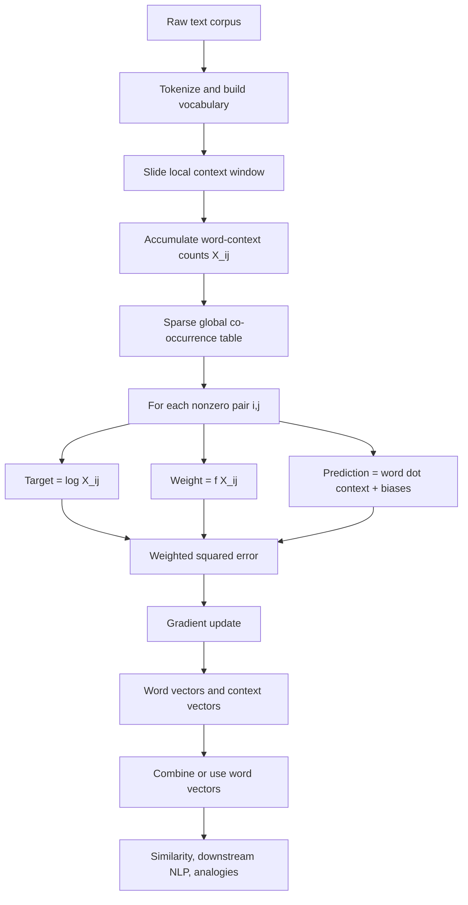
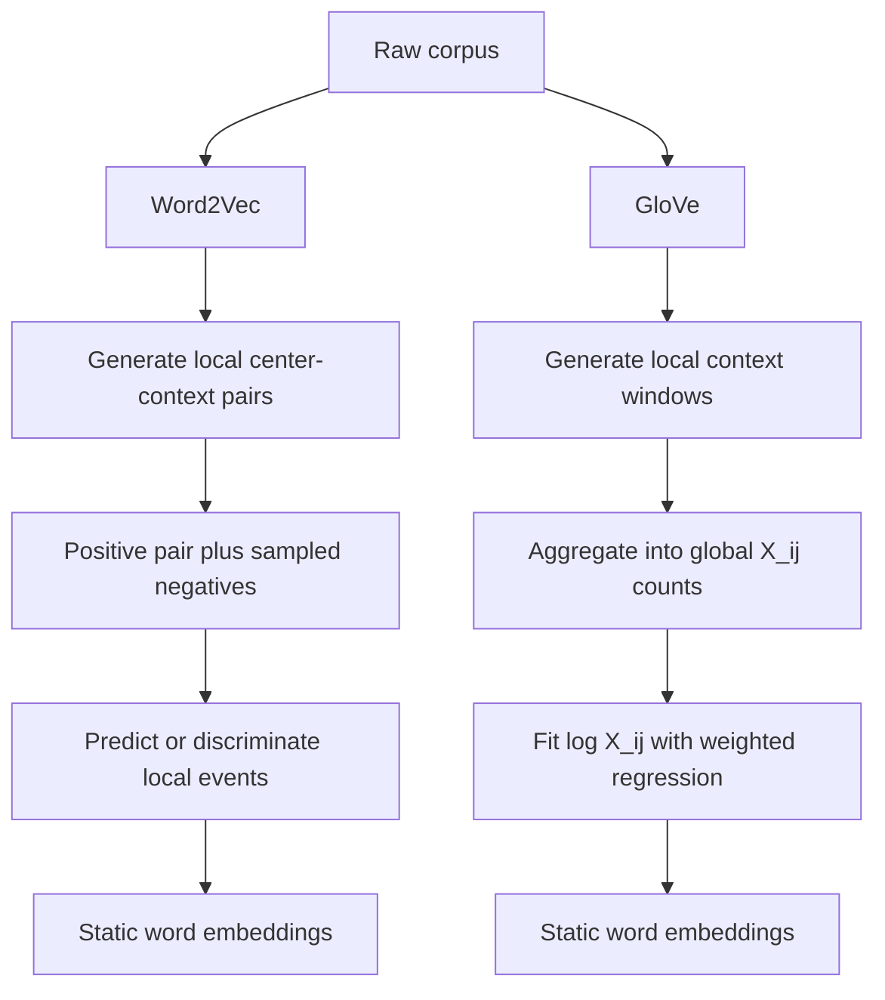

# AIResearch — Day 5 — GloVe: Global Vectors for Word Representation

> **Status:** ✅ Completed  
> **Day:** 5 of 99  
> **Paper:** _GloVe: Global Vectors for Word Representation_  
> **Authors:** Jeffrey Pennington, Richard Socher, Christopher D. Manning  
> **Venue:** EMNLP 2014  
> **Official PDF:** https://nlp.stanford.edu/pubs/glove.pdf  
> **ACL Anthology:** https://aclanthology.org/D14-1162/  
> **Stanford GloVe Project / Code / Pretrained Vectors:** https://nlp.stanford.edu/projects/glove/

---

## 0. Paper in One Paragraph

GloVe learns **static word embeddings** by combining the strongest ideas from two older families of methods: global matrix-factorization methods such as LSA and local predictive methods such as Skip-gram. The key insight is that semantic relationships are especially visible in **ratios of global word-context co-occurrence probabilities**. Taking a logarithm converts those ratios into differences, which matches the geometry of vector differences. The final model therefore learns word and context vectors so that their dot product plus biases approximates the **log co-occurrence count**, using a weighting function to down-weight rare/noisy pairs while preventing very frequent pairs from dominating training.

---

## 3. Core Notation

Let the global co-occurrence matrix be

$$
X.
$$

Each entry

$$
X_{ij}
$$

means:

> the number of times word \(j\) appears in the context window of word \(i\).

Define

$$
X_i = \sum_k X_{ik}.
$$

This is the total number of context-word observations around word \(i\).

Then define the conditional co-occurrence probability

$$
P_{ij}
=
P(j \mid i)
=
\frac{X_{ij}}{X_i}.
$$

So:

- \(X_{ij}\): raw pair count
- \(X_i\): total contexts around \(i\)
- \(P_{ij}\): probability of seeing \(j\) around \(i\)

---

## 4. The Central Insight: Probability Ratios

The paper argues that **ratios** of co-occurrence probabilities are more useful than individual probabilities.

Consider:

$$
i=\text{ice}
$$

and

$$
j=\text{steam}.
$$

Now probe both words using another word \(k\).

### If \(k = \text{solid}\)

We expect

$$
P(\text{solid}\mid\text{ice})
\gg
P(\text{solid}\mid\text{steam}).
$$

Therefore

$$
\frac{
P(\text{solid}\mid\text{ice})
}{
P(\text{solid}\mid\text{steam})
}
\gg 1.
$$

This means `solid` is much more characteristic of `ice`.

### If \(k = \text{gas}\)

$$
\frac{
P(\text{gas}\mid\text{ice})
}{
P(\text{gas}\mid\text{steam})
}
\ll 1.
$$

This means `gas` is much more characteristic of `steam`.

### If \(k = \text{water}\)

$$
\frac{
P(\text{water}\mid\text{ice})
}{
P(\text{water}\mid\text{steam})
}
\approx 1.
$$

### If \(k = \text{fashion}\)

$$
\frac{
P(\text{fashion}\mid\text{ice})
}{
P(\text{fashion}\mid\text{steam})
}
\approx 1.
$$

The ratio cancels much of the information that is common to both target words and highlights what **distinguishes** them.

### Actual values reported in the paper

| Probe \(k\) | \(P(k\mid ice)\) | \(P(k\mid steam)\) | Ratio |
| ----------- | -------------------: | -------------------: | -------------------: |
| solid       | \(1.9\times10^{-4}\) | \(2.2\times10^{-5}\) | \(8.9\) |
| gas         | \(6.6\times10^{-5}\) | \(7.8\times10^{-4}\) | \(8.5\times10^{-2}\) |
| water       | \(3.0\times10^{-3}\) | \(2.2\times10^{-3}\) | \(1.36\) |
| fashion     | \(1.7\times10^{-5}\) | \(1.8\times10^{-5}\) | \(0.96\) |

---

## 5. From Probability Ratios to Vector Differences

The authors want semantic relationships to appear as linear directions in embedding space.

For two target words \(i\) and \(j\), the natural vector representation of their relationship is

$$
w_i - w_j.
$$

So begin with a general function

$$
F(w_i, w_j, \tilde{w}_k)
=
\frac{P_{ik}}{P_{jk}},
$$

then require the function to depend on the vector difference:

$$
F(w_i-w_j,\tilde{w}_k)
=
\frac{P_{ik}}{P_{jk}}.
$$

Here:

- \(w_i\): target-word vector
- \(w_j\): second target-word vector
- \(\tilde{w}_k\): context-word vector

---

## 6. Why the Dot Product Appears

The left side currently contains vectors, while the right side is a scalar.

The authors intentionally avoid introducing a complicated neural network because they want to preserve linear structure.

They therefore use the dot product:

$$
F\left((w_i-w_j)^T\tilde{w}_k\right)
=
\frac{P_{ik}}{P_{jk}}.
$$

Expand the dot product:

$$
(w_i-w_j)^T\tilde{w}_k
=
w_i^T\tilde{w}_k
-
w_j^T\tilde{w}_k.
$$

This is already suggestive: a semantic relationship becomes a **difference of dot products**.

---

## 7. Why the Logarithm Is Fundamental

The key algebraic identity is

$$
\log\left(\frac{a}{b}\right)
=
\log a - \log b.
$$

A **ratio** becomes a **difference**.

This mirrors the vector relationship

$$
w_i-w_j.
$$

$$
\text{log difference}
\leftrightarrow
\text{vector difference}.
$$

This is the core mathematical intuition of GloVe.

---

## 8. Why the Exponential Function Appears in the Derivation

The paper requires a function satisfying

$$
F(a-b)
=
\frac{F(a)}{F(b)}.
$$

The exponential has exactly this property:

$$
e^{a-b}
=
\frac{e^a}{e^b}.
$$

Therefore the natural solution is

$$
F(x)=e^x.
$$

This leads to

$$
e^{w_i^T\tilde{w}_k} = P_{ik}.
$$

Taking logs:

$$
w_i^T\tilde{w}_k = \log P_{ik}.
$$

Since

$$
P_{ik} = \frac{X_{ik}}{X_i},
$$

we obtain

$$
w_i^T\tilde{w}_k = \log X_{ik} - \log X_i.
$$

---

## 9. Why Bias Terms Are Needed

The term

$$
-\log X_i
$$

depends on target word \(i\), but not on context word \(k\).

It can therefore be absorbed into a learned scalar bias:

$$
b_i.
$$

To restore symmetry between target and context roles, add another context bias

$$
\tilde{b}_k.
$$

This gives the crucial GloVe relationship:

$$
w_i^T\tilde{w}_k + b_i + \tilde{b}_k = \log X_{ik}.
$$

This is the structural equation behind the final model.

---

## 10. Why Predict \(\log X_{ij}\) Instead of \(X_{ij}\)?

Corpus counts are extremely heavy-tailed.

Example:

$$
1,\quad 1{,}000,\quad 1{,}000{,}000.
$$

Their logarithms are approximately

$$
0,\quad 6.91,\quad 13.82.
$$

So logarithms compress enormous count differences.

There is also the deeper theoretical reason:

$$
\log(a/b)=\log a-\log b.
$$

The logarithm simultaneously:

1. compresses skewed frequency statistics;
2. converts probability ratios into additive differences;
3. matches the desired vector-space geometry.

---

## 11. The Final GloVe Objective

The model minimizes

$$
J = \sum_{i,j=1}^{V} f(X_{ij}) \left( w_i^T \tilde{w}_j + b_i + \tilde{b}_j - \log X_{ij} \right)^2.
$$

Interpret it as weighted regression.

### Prediction

$$
\hat{y}_{ij}
=
w_i^T\tilde{w}_j+b_i+\tilde{b}_j.
$$

### Target

$$
y_{ij}
=
\log X_{ij}.
$$

### Weighted squared loss

$$
L_{ij}
=
f(X_{ij})
\left(
\hat{y}_{ij}-y_{ij}
\right)^2.
$$

Therefore:

> **GloVe is weighted least-squares regression over log global word-word co-occurrence counts.**

---

## 12. The Weighting Function

The paper chooses

$$
f(x)=
\begin{cases}
(x/x_{\max})^\alpha, & x < x_{\max} \\
1, & x \ge x_{\max}.
\end{cases}
$$

with

$$
x_{\max}=100
$$

and

$$
\alpha=\frac{3}{4}.
$$

The three design requirements are:

1. zero counts should contribute nothing;
2. rare counts should be down-weighted;
3. extremely frequent counts should not grow without bound.

---

## 13. Correct Interpretation of \(x_{\max}=100\)

This does **not** mean:

> ignore words that occur more than 100 times.

It acts on the **pair count \(X_{ij}\)**.

### Example: \(X_{ij}=1\)

$$
f(1)
=
\left(\frac{1}{100}\right)^{0.75}
\approx
0.0316.
$$

### Example: \(X_{ij}=50\)

$$
f(50)
=
(0.5)^{0.75}
\approx
0.595.
$$

### Example: \(X_{ij}=100\)

$$
f(100)=1.
$$

### Example: \(X_{ij}=100{,}000\)

$$
f(100{,}000)=1.
$$

So:

> \(x_{\max}=100\) is a **weight-saturation threshold**, not a corpus-frequency cutoff.

---

## 14. Why \(\alpha=3/4\)?

For counts below \(x_{\max}\),

$$
f(x)
=
\left(\frac{x}{100}\right)^{3/4}.
$$

The exponent makes weight increase sublinearly.

The authors report that

$$
\alpha=\frac34
$$

gave a modest empirical improvement over

$$
\alpha=1.
$$

This value is **empirically motivated**, not derived from first principles.

Do not confuse it with Word2Vec's \(3/4\) exponent.

### Word2Vec Day 4

$$
P_n(w)\propto U(w)^{3/4}
$$

controls **negative-sample selection**.

### GloVe Day 5

$$
f(x)
=
(x/x_{\max})^{3/4}
$$

controls **loss weighting**.

---

## 15. GloVe and Skip-gram Are More Related Than They First Appear

Skip-gram can be written as

$$
Q_{ij}
=
\frac{
\exp(w_i^T\tilde{w}_j)
}{
\sum_{k=1}^{V}
\exp(w_i^T\tilde{w}_k)
}.
$$

Its online negative log-likelihood is

$$
J
=
- \sum_{i\in corpus}
\sum_{j\in context(i)}
\log Q_{ij}.
$$

Group identical \((i,j)\) pairs together:

$$
J
=
-
\sum_i
\sum_j
X_{ij}\log Q_{ij}.
$$

Using

$$
P_{ij}
=
\frac{X_{ij}}{X_i},
$$

this becomes a weighted cross-entropy view.

So Skip-gram is also ultimately learning from corpus co-occurrence statistics.

The difference is the optimization formulation.

---

## 16. Word2Vec vs. GloVe — Precise Comparison

| Property                | Skip-gram / Word2Vec                     | GloVe                      |
| ----------------------- | ---------------------------------------- | -------------------------- |
| Raw source              | Local context windows                    | Local context windows      |
| Training representation | Individual/sampled events                | Aggregated global counts   |
| Core signal             | \(P(context\mid word)\)                  | \(\log X_{ij}\)           |
| Typical objective       | Prediction / discrimination              | Weighted least squares     |
| Full-softmax issue      | Yes                                      | No full-vocabulary softmax |
| Efficiency trick        | Negative sampling / hierarchical softmax | Sparse nonzero \(X_{ij}\) |
| Output                  | Static dense vectors                     | Static dense vectors       |

The correct statement is:

> Word2Vec trains directly on repeated local events; GloVe first aggregates those same local observations into global co-occurrence statistics and optimizes those statistics directly.

---

## 17. Relationship to Matrix Factorization

GloVe approximately reconstructs

$$
\log X_{ij}
$$

using low-dimensional factors:

$$
w_i^T\tilde{w}_j.
$$

Conceptually:

$$
\log X
\approx
W\tilde{W}^T
+
\text{bias terms}.
$$

The weighting function makes GloVe different from a plain unweighted SVD of the log-count matrix.

---

## 18. Computational Complexity

The loss only needs nonzero entries of \(X\).

Let

$$
|X|
$$

be the number of nonzero co-occurrence pairs.

Training therefore depends on

$$
|X|,
$$

not all

$$
V^2
$$

possible pairs.

Worst case:

$$
O(V^2).
$$

But language co-occurrence matrices are sparse.

The paper models pair counts using a power law:

$$
X_{ij}
=
\frac{k}{r_{ij}^{\alpha}}.
$$

For the corpora studied, the observed exponent was approximately

$$
\alpha=1.25.
$$

This gives the empirical scaling argument

$$
|X|
=
O(|C|^{0.8}),
$$

where \(|C|\) is corpus size.

---

## 19. Complete Architecture / Data Flow



---

## 20. Mathematical Derivation Map


---

## 21. Implementation From Scratch — Engineering View

The implementation pipeline is:

1. Read corpus.
2. Tokenize.
3. Build vocabulary.
4. Slide a context window.
5. Accumulate sparse \(X_{ij}\).
6. Initialize target vectors \(W\).
7. Initialize context vectors \(\tilde{W}\).
8. Initialize biases.
9. For every nonzero \(X_{ij}\):
   - compute \(\log X_{ij}\);
   - compute \(f(X_{ij})\);
   - compute dot-product prediction;
   - calculate weighted squared error;
   - update parameters.
10. Repeat for multiple epochs.
11. Use \(W\), \(\tilde{W}\), or a combination such as \(W+\tilde{W}\).

---

## 22. Minimal Python Implementation

```python
import numpy as np
from collections import defaultdict

corpus = [
    "king is a royal man",
    "queen is a royal woman",
    "prince is a royal man",
    "princess is a royal woman",
    "man is male",
    "woman is female",
    "king rules kingdom",
    "queen rules kingdom",
]

sentences = [s.lower().split() for s in corpus]

word_to_id = {}
id_to_word = {}

for sentence in sentences:
    for word in sentence:
        if word not in word_to_id:
            idx = len(word_to_id)
            word_to_id[word] = idx
            id_to_word[idx] = word

V = len(word_to_id)

window_size = 2
X = defaultdict(float)

for sentence in sentences:
    ids = [word_to_id[w] for w in sentence]

    for center_pos, i in enumerate(ids):
        left = max(0, center_pos - window_size)
        right = min(len(ids), center_pos + window_size + 1)

        for context_pos in range(left, right):
            if context_pos == center_pos:
                continue

            j = ids[context_pos]
            distance = abs(center_pos - context_pos)

            # Closer context positions receive stronger weight.
            X[(i, j)] += 1.0 / distance

D = 20
rng = np.random.default_rng(42)

W = rng.normal(0, 0.01, (V, D))
W_context = rng.normal(0, 0.01, (V, D))

b = np.zeros(V)
b_context = np.zeros(V)

X_MAX = 100.0
ALPHA = 0.75

def weight(x):
    if x < X_MAX:
        return (x / X_MAX) ** ALPHA
    return 1.0

learning_rate = 0.03
epochs = 200
pairs = list(X.items())

for epoch in range(epochs):
    rng.shuffle(pairs)
    total_loss = 0.0

    for (i, j), x in pairs:
        wi = W[i].copy()
        wj = W_context[j].copy()

        prediction = (
            np.dot(wi, wj)
            + b[i]
            + b_context[j]
        )

        target = np.log(x)
        error = prediction - target
        fx = weight(x)

        loss = fx * error ** 2
        total_loss += loss

        grad = 2.0 * fx * error

        W[i] -= learning_rate * grad * wj
        W_context[j] -= learning_rate * grad * wi

        b[i] -= learning_rate * grad
        b_context[j] -= learning_rate * grad

    if epoch % 20 == 0:
        print(epoch, total_loss)

embeddings = W + W_context
```

The most important implementation lines are:

```python
target = np.log(x)

prediction = (
    W[i] @ W_context[j]
    + b[i]
    + b_context[j]
)

loss = weight(x) * (prediction - target) ** 2
```

---

## 23. Gradient Intuition

For one pair:

$$
e_{ij}
=
w_i^T\tilde{w}_j
+
b_i
+
\tilde{b}_j
-
\log X_{ij}.
$$

Then

$$
L_{ij}
=
f(X_{ij})e_{ij}^2.
$$

Gradient with respect to the target vector:

$$
\frac{\partial L}{\partial w_i}
=
2f(X_{ij})e_{ij}\tilde{w}_j.
$$

Gradient with respect to the context vector:

$$
\frac{\partial L}{\partial \tilde{w}_j}
=
2f(X_{ij})e_{ij}w_i.
$$

Bias gradients:

$$
\frac{\partial L}{\partial b_i}
=
2f(X_{ij})e_{ij},
$$

$$
\frac{\partial L}{\partial \tilde{b}_j}
=
2f(X_{ij})e_{ij}.
$$

---

## 24. Why Analogies Emerge Without Analogy Labels

The model never receives labels such as:

> king : queen :: man : woman

Instead, many contexts jointly impose constraints.

If, for many probe words \(k\),

$$
\log
\frac{
P(k\mid king)
}{
P(k\mid queen)
}
$$

behaves similarly to

$$
\log
\frac{
P(k\mid man)
}{
P(k\mid woman)
},
$$

then GloVe is encouraged to produce

$$
w_{\text{king}} - w_{\text{queen}}
\approx
w_{\text{man}} - w_{\text{woman}}.
$$

Rearranging:

$$
w_{\text{king}}
-
w_{\text{man}}
+
w_{\text{woman}}
\approx
w_{\text{queen}}.
$$

Analogy structure emerges from **consistent co-occurrence-ratio constraints across many context words**.

---

## 25. Analogy Search in Code

```python
def cosine(a, b):
    return np.dot(a, b) / (
        np.linalg.norm(a) * np.linalg.norm(b) + 1e-12
    )

def analogy(a, b, c, embeddings, word_to_id, id_to_word, top_k=5):
    target = (
        embeddings[word_to_id[a]]
        - embeddings[word_to_id[b]]
        + embeddings[word_to_id[c]]
    )

    blocked = {a, b, c}
    scores = []

    for idx in range(len(id_to_word)):
        word = id_to_word[idx]

        if word in blocked:
            continue

        score = cosine(target, embeddings[idx])
        scores.append((word, score))

    scores.sort(key=lambda item: item[1], reverse=True)
    return scores[:top_k]
```

Typical large-corpus example:

```python
analogy("king", "man", "woman", ...)
```

Ideally returns `queen` near the top.

---

## 26. Experiments

The paper evaluates GloVe on:

1. word analogies;
2. word similarity;
3. named entity recognition.

The analogy benchmark contains

$$
19{,}544
$$

questions split into semantic and syntactic subsets.

For

$$
a:b::c:?
$$

find the word vector closest to

$$
w_b-w_a+w_c
$$

using cosine similarity.

---

## 27. Important Analogy Results

| Model | Dim | Corpus | Semantic | Syntactic |    Total |
| ----- | --: | -----: | -------: | --------: | -------: |
| GloVe | 100 |   1.6B |     67.5 |      54.3 |     60.3 |
| GloVe | 300 |   1.6B |     80.8 |      61.5 |     70.3 |
| GloVe | 300 |     6B |     77.4 |      67.0 |     71.7 |
| GloVe | 300 |    42B |     81.9 |      69.3 | **75.0** |

The headline result is approximately

$$
75\%
$$

total analogy accuracy for a 300-dimensional model trained on a 42-billion-token corpus.

---

## 28. Important Numbers to Remember

| Value | Meaning |
| --- | --- |
| \(x_{\max}=100\) | saturation threshold in weighting function |
| \(\alpha=3/4\) | sublinear weighting exponent |
| \(19{,}544\) | analogy questions |
| \(1.6B\) | one experimental corpus scale |
| \(6B\) | important corpus scale |
| \(42B\) | large corpus experiment |
| \(300\) | common embedding dimension |
| \(75.0\%\) | headline total analogy accuracy |
| \(\sim75\%-95\%\) | many possible matrix entries are zero |
| \(\alpha_{\text{power law}}\approx1.25\) | complexity-analysis exponent |
| \(O(\lvert C\rvert^{0.8})\) | nonzero-co-occurrence scaling argument |

Do not confuse:

- weighting exponent \(3/4\);
- complexity derivation exponent \(\approx1.25\).

They are unrelated parameters.

---

## 29. Limitations

### Static embeddings

GloVe learns one vector per word.

The word `bank` has the same embedding in:

> deposit money at the bank

and

> sit beside the river bank

Different senses are mixed into one static vector.

### Fixed vocabulary

Unknown words do not naturally receive useful vectors.

This becomes important in Day 6.

### Context is collapsed

Once training finishes, the vector does not change with sentence context.

### Global statistics require preprocessing

The co-occurrence table must be accumulated before the regression stage.

---

## 30. GloVe vs. Day 4 Word2Vec — Final Mental Model



---

## 31. Complete Derivation to Recall

$$
X_{ij}
$$

$$
\Downarrow
$$

$$
P_{ij}=\frac{X_{ij}}{X_i}
$$

$$
\Downarrow
$$

$$
\frac{P_{ik}}{P_{jk}}
$$

$$
\Downarrow
$$

$$
\log\frac{P_{ik}}{P_{jk}}
=
\log P_{ik}-\log P_{jk}
$$

$$
\Downarrow
$$

$$
w_i-w_j
$$

$$
\Downarrow
$$

$$
(w_i-w_j)^T\tilde{w}_k
$$

$$
\Downarrow
$$

$$
w_i^T\tilde{w}_k
\approx
\log P_{ik}
$$

$$
\Downarrow
$$

$$
w_i^T\tilde{w}_k+b_i+\tilde{b}_k
\approx
\log X_{ik}
$$

$$
\Downarrow
$$

$$
J
=
\sum_{ij}
f(X_{ij})
\left(
w_i^T\tilde{w}_j+b_i+\tilde{b}_j-\log X_{ij}
\right)^2.
$$

---

## 32. Three-Sentence Summary

GloVe aggregates local context observations into a sparse global co-occurrence matrix and argues that ratios of co-occurrence probabilities expose semantic relationships better than individual probabilities. Taking logarithms converts those probability ratios into differences, naturally connecting corpus statistics to vector differences, while the final weighted least-squares objective fits vector dot products and biases to log co-occurrence counts. The result is a simple static embedding model with strong analogy, similarity, and NER performance that bridges global count-based methods and local predictive embedding methods.

---

## 33. Mastery Checklist

- [x] Understand \(X_{ij}\), \(X_i\), and \(P_{ij}\).
- [x] Understand the ice/steam ratio example.
- [x] Understand why ratios are more discriminative than probabilities alone.
- [x] Understand why \(\log(a/b)=\log a-\log b\) matters.
- [x] Understand why semantic relationships use \(w_i-w_j\).
- [x] Understand why the dot product appears.
- [x] Understand why the exponential appears in the derivation.
- [x] Understand bias terms.
- [x] Understand why the target is \(\log X_{ij}\).
- [x] Understand weighted least squares.
- [x] Understand \(x_{\max}=100\).
- [x] Understand \(\alpha=3/4\).
- [x] Distinguish Word2Vec's \(3/4\) from GloVe's \(3/4\).
- [x] Understand relation to Skip-gram.
- [x] Understand sparse storage and complexity.
- [x] Understand how analogies emerge.
- [x] Understand the implementation from raw corpus to final vectors.
- [x] Understand major experimental results.
- [x] Understand static-embedding limitations.

---
