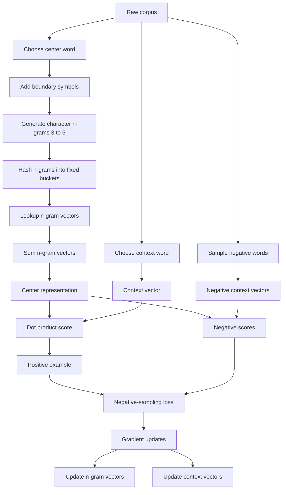
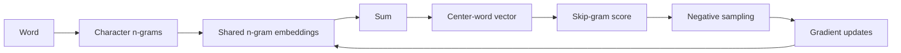

# AIResearch — Day 6 — Enriching Word Vectors with Subword Information

> **Status:** ✅ Completed  
> **Day:** 6 of 99  
> **Paper:** *Enriching Word Vectors with Subword Information*  
> **Authors:** Piotr Bojanowski, Edouard Grave, Armand Joulin, Tomas Mikolov  
> **Year:** 2017  
> **Model:** fastText-style subword Skip-gram  
> **Official paper:** https://arxiv.org/abs/1607.04606  
> **Project:** https://fasttext.cc/  
> **Code:** https://github.com/facebookresearch/fastText  

---

## 0. Paper in One Paragraph

This paper improves classic Skip-gram word embeddings by representing a word not only as an atomic vocabulary item, but as a **bag of character n-grams**. Each character n-gram gets its own vector, and a word representation is built by summing the vectors of its n-grams. Training still follows the Skip-gram idea of predicting nearby context words and still uses negative sampling for efficiency. The key benefit is **parameter sharing**: related words such as `play`, `played`, `playing`, and `player` reuse some of the same subword parameters, which improves representations for rare words, morphologically rich languages, and even words that never appeared in the training vocabulary. The paper shows that this simple change improves word similarity, syntactic analogy performance, low-data robustness, and downstream language-model initialization, while remaining computationally practical.

---

## 1. Why This Paper Was Needed

Classic Word2Vec learns approximately:

$$
\text{one word}
\rightarrow
\text{one learned vector}
$$

That creates three important problems:

1. **Rare words** receive few useful updates.
2. **Morphologically related words** do not automatically share parameters.
3. **Out-of-vocabulary words** have no whole-word embedding.

Example:

```text
play
played
playing
player
playful
```

FastText asks:

> Why not reuse the internal character structure shared by these words?

Its answer is to represent words with **character n-grams**.

---

## 2. Main Idea

For a word \(w\), define its set of character n-grams:

$$
G_w.
$$

Each n-gram \(g\) has an embedding:

$$
z_g.
$$

The word representation is:

$$
u_w
=
\sum_{g\in G_w} z_g.
$$

Classic Skip-gram learns one atomic \(u_w\).

FastText builds \(u_w\) from reusable subword vectors.

---

## 3. Skip-Gram Foundation

Given corpus:

$$
w_1,w_2,\ldots,w_T,
$$

Skip-gram trains a center word to predict context words.

The objective is:

$$
\sum_{t=1}^{T}
\sum_{c\in C_t}
\log p(w_c \mid w_t),
$$

where \(C_t\) is the context of \(w_t\).

A normal Skip-gram score is:

$$
s(w_t,w_c)
=
u_{w_t}^{T}v_{w_c},
$$

where:

- \(u_w\): input / center vector
- \(v_w\): output / context vector

---

## 4. Why Negative Sampling Is Still Used

A full softmax is:

$$
p(w_c \mid w_t)
=
\frac{
\exp(s(w_t,w_c))
}{
\sum_{j=1}^{W}\exp(s(w_t,j))
}.
$$

The denominator requires scoring the whole vocabulary.

FastText therefore retains the Word2Vec binary-classification approach.

For a real pair \((w_t,w_c)\), the model also samples negatives \(n\).

With logistic loss:

$$
\ell(x)=\log(1+e^{-x}),
$$

the per-example objective is:

$$
\ell(s(w_t,w_c))
+
\sum_{n\in N_{t,c}}
\ell(-s(w_t,n)).
$$

The goal is:

$$
s(w_t,w_c)\uparrow
$$

for the real pair and:

$$
s(w_t,n)\downarrow
$$

for negatives.

**FastText does not make negative sampling faster.**  
It changes the representation inside the score.

---

## 5. What FastText Changes

Classic Skip-gram:

$$
s(w,c)
=
u_w^Tv_c.
$$

FastText:

$$
u_w
=
\sum_{g\in G_w}z_g.
$$

Therefore:

$$
s(w,c)
=
\left(
\sum_{g\in G_w}z_g
\right)^Tv_c
$$

or equivalently:

$$
\boxed{
s(w,c)
=
\sum_{g\in G_w}
z_g^Tv_c
}
$$

This is the core equation of the paper.

---

## 6. Example: `where`

The paper adds boundary symbols:

```text
where
```

becomes:

```text
<where>
```

For \(n=3\), the paper gives:

```text
<wh
whe
her
ere
re>
```

and also includes:

```text
<where>
```

as the whole-word sequence.

So conceptually:

$$
u_{\text{where}}
=
z_{\text{<wh}}
+
z_{\text{whe}}
+
z_{\text{her}}
+
z_{\text{ere}}
+
z_{\text{re>}}
+
z_{\text{<where>}}.
$$

The paper uses character n-grams with:

$$
3 \le n \le 6.
$$

---

## 7. Why Boundary Symbols Matter

Boundary markers distinguish:

- beginning-of-word pieces,
- internal pieces,
- end-of-word pieces,
- the complete word.

For example:

```text
her
```

inside `where` is not the same structural object as:

```text
<her>
```

representing the standalone word `her`.

This gives the model useful information about:

- prefixes,
- suffixes,
- roots,
- compound-word boundaries.

---

## 8. The Deepest Improvement: Parameter Sharing

The main benefit is not simply "using spelling."

The real mechanism is:

$$
\boxed{
\text{shared n-grams}
\rightarrow
\text{shared parameters}
\rightarrow
\text{shared gradient updates}
}
$$

Consider:

```text
play
playing
played
player
```

They share pieces such as:

```text
pla
play
lay
```

If frequent examples of `play` update these subword vectors, rarer forms reuse them.

That improves sample efficiency.

---

## 9. Gradient-Level Intuition

Suppose:

```text
playing -> football
```

is a positive pair.

Let:

$$
G_{\text{playing}}
=
\{g_1,g_2,\ldots,g_m\}.
$$

Then:

$$
s
=
\sum_{g\in G_{\text{playing}}}
z_g^Tv_{\text{football}}.
$$

If the score must increase, gradients flow into:

$$
z_{g_1},z_{g_2},\ldots,z_{g_m}.
$$

Later:

```text
played -> football
```

reuses some of those same n-gram vectors.

Knowledge transfers across related word forms.

---

## 10. Why Rare Words Improve

Suppose:

```text
play
```

appears 1,000,000 times.

But:

```text
playfulness
```

appears only 20 times.

Classic Skip-gram mostly learns `playfulness` from those 20 observations.

FastText can reuse subword vectors also trained through:

```text
play
playing
player
playful
```

Therefore:

$$
\boxed{
\text{rare word}
+
\text{well-trained shared subwords}
\rightarrow
\text{better vector}
}
$$

---

## 11. Out-of-Vocabulary Words

Suppose:

```text
microcircuit
```

never appeared in the training vocabulary.

Classic Word2Vec has no whole-word vector for it.

FastText can extract its n-grams and combine learned subword vectors:

$$
u_{\text{microcircuit}}
=
\sum_{g\in G_{\text{microcircuit}}}
z_g.
$$

So an unseen whole word can still receive a meaningful vector.

---

## 12. Hashing the N-Grams

The number of possible character n-grams can become enormous.

FastText hashes n-grams into a fixed bucket table:

$$
\text{bucket}(g)
=
h(g)\bmod K.
$$

The paper uses:

$$
K=2\times10^6
$$

buckets and FNV-1a hashing.

This bounds memory usage.

---

## 13. Hash Collisions

Hashing can map two unrelated n-grams to the same bucket:

$$
h(g_1)\bmod K
=
h(g_2)\bmod K.
$$

Then they accidentally share one embedding.

Tradeoff:

$$
\text{larger }K
\rightarrow
\text{more memory}
\rightarrow
\text{fewer collisions}
$$

versus:

$$
\text{smaller }K
\rightarrow
\text{less memory}
\rightarrow
\text{more collisions}.
$$

---

## 14. Complete Training Architecture



---

## 15. Training Setup

The paper's main setup is:

| Parameter | Value |
|---|---:|
| Embedding dimension | 300 |
| Negative samples | 5 |
| Negative sampling distribution | proportional to square root of unigram frequency |
| Context window | uniformly sampled from 1 to 5 |
| Frequent-word subsampling threshold | \(10^{-4}\) |
| Minimum word count | 5 |
| Number of passes | 5 |
| Skip-gram initial learning rate | 0.025 |
| Subword model initial learning rate | 0.05 |
| Optimizer | SGD |
| Parallelization | Hogwild asynchronous updates |

Learning rate decay:

$$
\gamma_t
=
\gamma_0
\left(
1-\frac{t}{TP}
\right).
$$

---

## 16. Training Speed

The paper reports:

| Model | Speed |
|---|---:|
| Skip-gram | 145k words/sec/thread |
| Subword Skip-gram | 105k words/sec/thread |

So FastText is roughly:

$$
1.5\times
$$

slower in that setup.

The reason is straightforward: each center word now requires multiple n-gram lookups, additions, and parameter updates.

FastText therefore improves **representation quality**, not raw training speed.

---

## 17. Training Data

The main experiments use Wikipedia data from nine languages:

1. Arabic
2. Czech
3. German
4. English
5. Spanish
6. French
7. Italian
8. Romanian
9. Russian

The data is normalized, shuffled, and used for five training passes.

---

## 18. Why Morphologically Rich Languages Matter

Languages differ in the amount of morphology they encode in word forms.

German and Russian are useful examples because they have:

- grammatical inflections,
- multiple cases,
- productive compounding.

Example:

```text
Tischtennis
```

contains:

```text
Tennis
```

FastText can exploit this internal similarity rather than treating the two words as fully unrelated.

---

## 19. Experiment 1 — Human Word Similarity

The paper compares cosine similarity of embeddings with human similarity judgments using Spearman correlation.

Representative results:

| Dataset | Skip-gram | CBOW | Subword without OOV | Subword with OOV |
|---|---:|---:|---:|---:|
| AR WS353 | 51 | 52 | 54 | 55 |
| DE GUR350 | 61 | 62 | 64 | **70** |
| DE GUR65 | 78 | 78 | 81 | **81** |
| DE ZG222 | 35 | 38 | 41 | **44** |
| EN RW | 43 | 43 | 46 | **47** |
| EN WS353 | 72 | **73** | 71 | 71 |
| ES WS353 | 57 | 58 | 58 | **59** |
| FR RG65 | 70 | 69 | **75** | **75** |
| RO WS353 | 48 | 52 | 51 | **54** |
| RU HJ | 59 | 60 | 60 | **66** |

Main pattern:

$$
\boxed{
\text{largest gains}
\rightarrow
\text{rare words and morphologically rich languages}
}
$$

---

## 20. Why Common English Words Improve Less

If a word appears millions of times, Skip-gram already gets strong context statistics.

Subword information may add relatively little.

That explains why English WS353 is nearly flat while English Rare Words improves.

The important lesson is:

$$
\boxed{
\text{subword information matters most when whole-word evidence is weak}
}
$$

---

## 21. Experiment 2 — Word Analogies

The paper separates:

- semantic analogies,
- syntactic analogies.

Results:

| Language | Type | Skip-gram | CBOW | Subword Skip-gram |
|---|---|---:|---:|---:|
| Czech | Semantic | 25.7 | 27.6 | 27.5 |
| Czech | Syntactic | 52.8 | 55.0 | **77.8** |
| German | Semantic | 66.5 | **66.8** | 62.3 |
| German | Syntactic | 44.5 | 45.0 | **56.4** |
| English | Semantic | **78.5** | 78.2 | 77.8 |
| English | Syntactic | 70.1 | 69.9 | **74.9** |
| Italian | Semantic | 52.3 | **54.7** | 52.3 |
| Italian | Syntactic | 51.5 | 51.8 | **62.7** |

The result is very clear:

$$
\boxed{
\text{subwords strongly improve syntactic analogies}
}
$$

but:

$$
\boxed{
\text{subwords do not consistently improve semantic analogies}
}
$$

---

## 22. Why Syntax Improves More Than Semantics

Character structure often carries:

- tense,
- plural,
- suffixes,
- prefixes,
- conjugation,
- declension.

Example:

```text
walk
walked
walking
```

But spelling does not encode arbitrary world knowledge:

```text
Paris -> France
Tokyo -> Japan
```

So morphology is naturally more useful for syntax than for many semantic relations.

---

## 23. Experiment 3 — Comparison With Morphology-Aware Methods

The paper compares against earlier methods using:

- recursive morphology,
- morpheme-aware CBOW,
- prefix/suffix transformations,
- morphological log-bilinear models.

The subword Skip-gram method performs strongly without requiring an external morphological segmenter.

Key practical result:

$$
\boxed{
\text{useful morphology can emerge from raw character n-grams}
}
$$

without supervised morphological preprocessing.

---

## 24. Experiment 4 — Effect of Training Data Size

The authors train on:

$$
1\%, 2\%, 5\%, 10\%, 20\%, 50\%
$$

of Wikipedia.

The hypothesis:

> parameter sharing should make the model more data-efficient.

The results support that.

### German GUR350

FastText using:

$$
5\%
$$

of the data gets:

$$
66
$$

while CBOW using:

$$
100\%
$$

gets:

$$
62.
$$

### English Rare Words

FastText using:

$$
1\%
$$

of Wikipedia gets:

$$
45
$$

while CBOW using the full data gets:

$$
43.
$$

This is a major result:

$$
\boxed{
\text{parameter sharing}
\rightarrow
\text{better sample efficiency}
}
$$

---

## 25. Experiment 5 — Effect of N-Gram Length

The main model uses:

$$
3\text{ to }6
$$

characters.

The experiments show:

- 3–6 is a good general choice,
- the best range depends on language and task,
- long n-grams help compounds,
- 2-grams are often too weak.

Short n-grams:

$$
\text{high reuse but low specificity}
$$

Long n-grams:

$$
\text{higher specificity but less sharing}
$$

So 3–6 is a useful compromise.

---

## 26. Experiment 6 — Language Modeling

The authors initialize an LSTM language model using the learned embeddings.

The downstream model uses:

- 650 LSTM units
- dropout \(0.5\)
- weight decay \(10^{-5}\)
- Adagrad
- learning rate \(0.1\)
- gradient clipping at norm \(1.0\)
- batch size 20

Test perplexity:

| Model | CS | DE | ES | FR | RU |
|---|---:|---:|---:|---:|---:|
| CLBL | 465 | 296 | 200 | 225 | 304 |
| CANLM | 371 | 239 | 165 | 184 | 261 |
| LSTM | 366 | 222 | 157 | 173 | 262 |
| Skip-gram init | 339 | 216 | 150 | 162 | 237 |
| Subword init | **312** | **206** | **145** | **159** | **206** |

The gains are strongest for morphologically rich languages, especially Czech and Russian.

---

## 27. Qualitative Morphology Analysis

The paper checks which n-grams contribute most strongly.

Examples:

### German

`Autofahrer`

important pieces include:

```text
Auto
Fahrer
```

### English

`lifetime`

important pieces include:

```text
life
time
```

`kindness`

includes useful suffix structure around:

```text
ness
```

`unlucky`

contains useful prefix structure around:

```text
un
```

### French

verb endings such as:

```text
ais
ent
ions
```

emerge as useful.

The model was never given a morphology parser.

---

## 28. Important Nuance: N-Grams Are Not Morphemes

FastText does not explicitly segment:

```text
unhappiness
-> un + happy + ness
```

It generates overlapping character n-grams.

Some happen to align with real morphemes because those pieces are statistically useful.

Therefore:

$$
\boxed{
\text{character n-gram}
\neq
\text{morpheme}
}
$$

even though useful n-grams can often correspond to morphemes.

---

## 29. OOV Qualitative Analysis

The paper examines unseen words such as:

- `microcircuit`
- `rarity`
- `scarceness`
- `preadolescent`

It finds meaningful subword matching patterns, including pieces corresponding roughly to:

- `micro`
- `circuit`
- suffix relations
- `adolesc`

This supports the claim that OOV representations retain meaningful structure.

---

## 30. FastText vs. Word2Vec

| Property | Word2Vec Skip-gram | FastText |
|---|---|---|
| Center representation | Whole-word vector | Sum of n-gram vectors |
| Context prediction | Yes | Yes |
| Negative sampling | Yes | Yes |
| Parameter sharing | Limited | Strong |
| Rare words | Weak | Better |
| OOV words | Usually unavailable | Can be constructed |
| Morphology | Only implicit | Character structure directly used |
| Training cost | Lower | Higher |
| Static embeddings | Yes | Yes |

---

## 31. FastText vs. GloVe

GloVe asks:

> How can global co-occurrence statistics improve embedding learning?

FastText asks:

> How can internal word structure improve the representation itself?

So:

$$
\text{GloVe}
\rightarrow
\text{improves the statistical learning signal}
$$

while:

$$
\text{FastText}
\rightarrow
\text{improves the word representation}.
$$

---

## 32. FastText vs. BPE

This distinction is critical.

### FastText

```text
playing football
```

still uses `playing` as a word-level training item.

Internally, `playing` is represented by many overlapping character n-grams.

### BPE

A tokenizer may instead produce:

```text
play + ing
```

and these become actual sequence tokens.

Therefore:

$$
\boxed{
\text{FastText enriches one word vector with subword features}
}
$$

while:

$$
\boxed{
\text{BPE changes the vocabulary and token sequence itself}
}
$$

---

## 33. Minimal Implementation

```python
def char_ngrams(word, min_n=3, max_n=6):
    token = f"<{word}>"
    grams = []

    for n in range(min_n, max_n + 1):
        for i in range(len(token) - n + 1):
            grams.append(token[i:i+n])

    grams.append(token)
    return grams
```

Hashing:

```python
NUM_BUCKETS = 2_000_000

def bucket(ngram):
    return fnv1a(ngram) % NUM_BUCKETS
```

Word representation:

```python
def word_vector(word, Z):
    grams = char_ngrams(word)
    return sum(Z[bucket(g)] for g in grams)
```

Context score:

```python
center = word_vector(word, Z)

score = center @ context_embeddings[context_id]
```

---

## 34. One Concrete Example

Tiny corpus:

```text
I play football
We play football
They play football
Children play football
He is playing football
```

`play` is frequent.

`playing` appears once.

Classic Skip-gram learns:

$$
u_{\text{play}}
$$

and:

$$
u_{\text{playing}}
$$

mostly independently.

FastText uses:

$$
u_{\text{playing}}
=
\sum_{g\in G_{\text{playing}}}z_g.
$$

Shared n-grams between `play` and `playing` were already updated by the frequent examples of `play`.

So the rare word receives a better starting statistical representation.

---

## 35. What FastText Did Not Solve

FastText is still a **static embedding model**.

The word:

```text
bank
```

gets essentially one representation in both:

```text
financial bank
river bank
```

FastText improves:

$$
\boxed{
\text{rare words + morphology + OOV handling}
}
$$

but not:

$$
\boxed{
\text{context-dependent meaning}
}
$$

That requires contextual embeddings later.

---

## 36. Main Engineering Lesson

The biggest transferable idea is:

$$
\boxed{
\text{parameter sharing improves sample efficiency}
}
$$

FastText shares n-gram parameters across many related words.

This general principle appears throughout modern machine learning.

---

## 37. The Whole Paper in Five Equations

### Skip-gram objective

$$
\sum_t
\sum_{c\in C_t}
\log p(w_c\mid w_t)
$$

### Logistic loss

$$
\ell(x)=\log(1+e^{-x})
$$

### Word representation

$$
u_w
=
\sum_{g\in G_w}z_g
$$

### FastText score

$$
s(w,c)
=
\sum_{g\in G_w}z_g^Tv_c
$$

### Hash bucket

$$
\text{bucket}(g)
=
h(g)\bmod K
$$

with:

$$
K=2\times10^6.
$$

---

## 38. Complete Mental Model



Core feedback loop:

$$
\boxed{
\text{shared subwords}
\rightarrow
\text{shared gradients}
\rightarrow
\text{better rare-word learning}
}
$$

---

## 39. Main Experimental Conclusions

The experiments jointly show:

1. **Rare words improve.**
2. **Morphologically rich languages benefit more.**
3. **OOV words can receive useful vectors.**
4. **Syntactic analogies improve strongly.**
5. **Low-data training becomes more effective.**
6. **Language-model initialization improves.**
7. **Semantic analogy improvements are not guaranteed.**
8. **Training is somewhat slower than plain Skip-gram.**

---

## 40. Three-Sentence Summary

FastText extends Skip-gram by replacing an atomic center-word vector with a sum of character n-gram vectors while retaining context prediction and negative sampling. Shared n-gram parameters allow related words to share gradient information, producing better representations for rare words, morphologically rich languages, and unseen words. The experiments show particularly strong gains in syntactic analogies, low-data regimes, OOV handling, and downstream language-model initialization, while semantic gains are less consistent.

---

## 41. Mastery Checklist

- [x] Understand why one-vector-per-word is limiting.
- [x] Understand the Skip-gram objective.
- [x] Understand why negative sampling remains.
- [x] Understand character n-gram decomposition.
- [x] Understand boundary symbols.
- [x] Understand the 3–6 n-gram range.
- [x] Understand \(u_w=\sum z_g\).
- [x] Understand the FastText scoring function.
- [x] Understand parameter sharing.
- [x] Understand rare-word improvement.
- [x] Understand OOV vector construction.
- [x] Understand hashing.
- [x] Understand hash collisions.
- [x] Understand the experimental setup.
- [x] Understand training-speed tradeoffs.
- [x] Understand similarity results.
- [x] Understand analogy results.
- [x] Understand why syntax benefits more than semantics.
- [x] Understand low-data experiments.
- [x] Understand n-gram-size experiments.
- [x] Understand language-model experiments.
- [x] Understand qualitative morphology results.
- [x] Understand that character n-grams are not necessarily morphemes.
- [x] Understand FastText vs. Word2Vec.
- [x] Understand FastText vs. GloVe.
- [x] Understand FastText vs. BPE.
- [x] Understand that FastText remains a static embedding model.

---

## 42. Day 6 Exam — No Answers

1. What limitation of ordinary Skip-gram motivates FastText?
2. What is \(G_w\)?
3. What does \(z_g\) represent?
4. Explain \(u_w=\sum_{g\in G_w}z_g\).
5. How is FastText's score different from ordinary Skip-gram?
6. Why use boundary symbols?
7. Why use multiple n-gram lengths?
8. Why is 3–6 a reasonable range?
9. Why are 2-grams often weak?
10. Why does parameter sharing improve rare words?
11. What receives gradients when `playing -> football` is a positive pair?
12. How can `played` benefit from training on `playing`?
13. How can FastText represent an unseen word?
14. Why can classic Word2Vec not naturally do the same?
15. Why use hashing?
16. What is a hash collision?
17. What tradeoff does bucket count control?
18. What negative-sampling setup does the paper use?
19. Why is FastText slower than plain Skip-gram?
20. Why does it help morphologically rich languages more?
21. Why do syntactic analogies improve more than semantic analogies?
22. What do the low-data experiments show?
23. Why can FastText trained on 5% of German data beat CBOW trained on 100% on one benchmark?
24. What do the n-gram-length experiments show?
25. What does the language-model experiment demonstrate?
26. Why are useful n-grams not necessarily true morphemes?
27. Explain FastText vs. Word2Vec.
28. Explain FastText vs. GloVe.
29. Explain FastText vs. BPE.
30. Describe the complete algorithm from raw corpus to final embeddings.

---

## 43. AIResearch Progress

```text
Day 1 — Attention Is All You Need
✅ Completed

Day 2 — A Neural Probabilistic Language Model
✅ Completed

Day 3 — Efficient Estimation of Word Representations in Vector Space
✅ Completed

Day 4 — Distributed Representations of Words and Phrases and Their Compositionality
✅ Completed

Day 5 — GloVe: Global Vectors for Word Representation
✅ Completed

Day 6 — Enriching Word Vectors with Subword Information
✅ Completed

Day 7 — Neural Machine Translation of Rare Words with Subword Units
🟡 Next
```

---

## 44. Next Paper — Day 7

### Neural Machine Translation of Rare Words with Subword Units

**Authors:** Rico Sennrich, Barry Haddow, Alexandra Birch  
**Year:** 2016

The next question is:

> Should words remain the fundamental vocabulary unit at all?

This introduces **Byte Pair Encoding (BPE)** for subword tokenization.

Conceptual transition:

$$
\text{FastText}
\rightarrow
\text{subwords enrich a word vector}
$$

becomes:

$$
\text{BPE}
\rightarrow
\text{subwords become the actual model tokens}.
$$

This is the bridge from classic word embeddings to the tokenization systems used by modern language models.
